# Idiomiko™ user guide

Idiomiko teaches a language through reading. You read short lessons, books or the news; every
word is a button; the words you save become flashcards. This guide covers the everyday things,
one screen at a time.

The screenshots come from the web app with Spanish as the language being learned. The desktop,
Android and iOS apps look the same; on a phone the menus move to a bar at the bottom
([see below](#on-a-phone)).

- [Install](#install)
- [First start](#first-start)
- [Home](#home)
- [Courses and lessons](#courses-and-lessons)
- [Reading and saving words](#reading-and-saving-words)
- [Flashcards](#flashcards)
- [Vocabulary](#vocabulary)
- [Your own books and texts](#your-own-books-and-texts)
- [News and Wikipedia](#news-and-wikipedia)
- [Playlists](#playlists)
- [On a phone](#on-a-phone)
- [Settings worth knowing](#settings-worth-knowing)
- [Keyboard shortcuts](#keyboard-shortcuts)
- [Questions](#questions)

## Install

Downloads are on the [latest release](https://github.com/zavanton123/tayra-languages/releases/latest).

| Platform | File | Notes |
| --- | --- | --- |
| Browser | [app.idiomiko.com](https://app.idiomiko.com) | Nothing to install. The library lasts only for the browser session, so sign in to sync or make a backup before closing the tab. |
| Windows | `…-windows-x64.msi` | Not signed: on "Windows protected your PC", choose **More info → Run anyway**. |
| macOS (Apple silicon) | `…-macos-arm64.dmg` | Drag Idiomiko to Applications. |
| Linux | `.deb`, `.rpm` or `.tar.gz` | `sudo apt install ./Idiomiko-….deb` or `sudo dnf install ./Idiomiko-….rpm`. |
| Android | `….apk` | Allow installs from your browser or file manager when asked. |
| iPhone, iPad | `…-ios-unsigned.ipa` | Install with [AltStore](https://altstore.io) or [Sideloadly](https://sideloadly.io). With a free Apple ID it needs refreshing every 7 days. |

The desktop app tells you when a new version is out and installs it when you ask.

## First start

Pick the language you want to learn. Type in the search box to find it quickly.

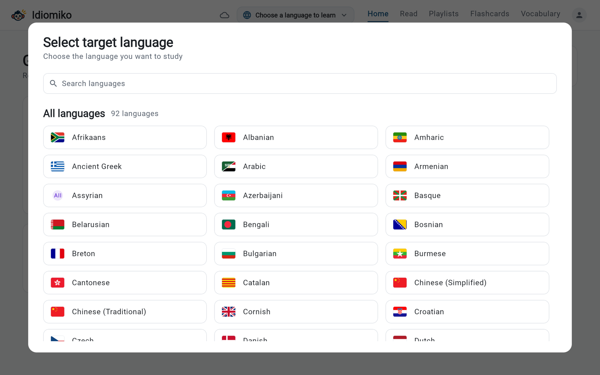

Then say how much you already know. Idiomiko marks the most common words of your level as known,
so lessons only highlight what is new to you. You can change the level later in
**Settings › Vocabulary**.

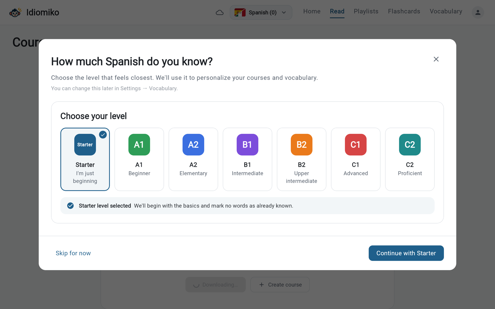

To learn a second language, use the language button in the top bar. **Settings › Languages** also
sets the language meanings are shown in and the language of the app itself.

## Home

Home shows one suggested next step and what keeps you going:

- **Today's goal**: minutes of reading and flashcards. Change it in **Settings › Goals**.
- **Streak**: days in a row you studied. Click it to see your statistics.
- **Next up**: the next lesson, or your book, in one click.
- **Continue learning**: flashcards due today and anything you are halfway through.
- **Vocabulary**: how much of the most common words you know, and the words you saved recently.

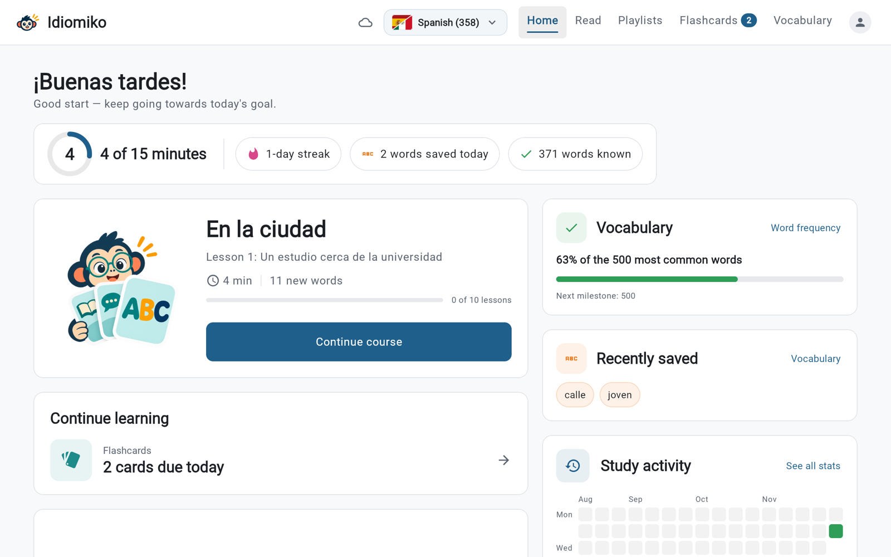

## Courses and lessons

**Read › Courses** has graded courses of short stories, from A1 to C2. The course for your level
comes first; the numbered circles are its lessons. **Create your own course** turns your own texts
into lessons.

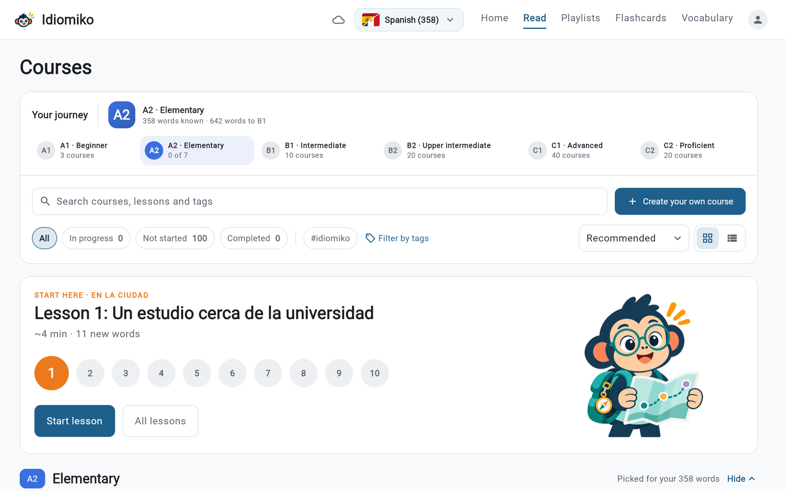

A lesson takes a few minutes. Each lesson is worked through in stages, shown in the bar at the
bottom of the screen. The green tick finishes the current stage and moves to the next. Click any
stage's icon to jump straight to it.

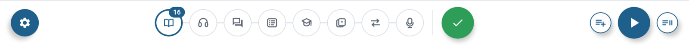

| Stage | What you do |
| --- | --- |
| Read aloud | Read the text aloud and tap the words you don't know. Finishing it marks every other word as known. |
| Listen | Listen with the play button while the original is blurred. Point at, or on a phone tap, a sentence to see it. |
| Questions | Answer questions on the story, then compare with the blurred answer. |
| Check the words | Go over the page's words and fix their statuses. |
| Quiz | A quick quiz on the words you are learning. |
| Flashcards | Review today's cards without leaving the text. |
| Reverse translation | Say each translated sentence in the original, then compare. |
| Retell | Tell the story again, with only its translation in front of you. |

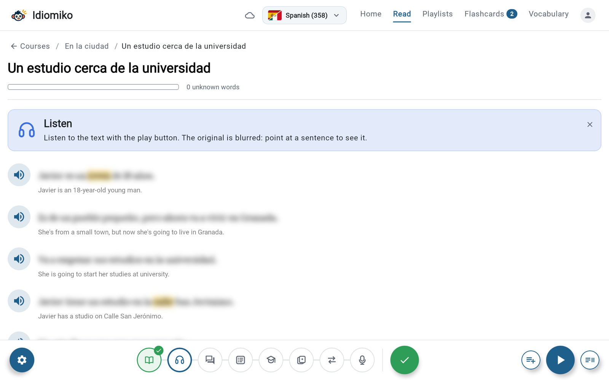

## Reading and saving words

Words you have never met are highlighted in blue, words you are learning in yellow, and known words
not at all. So a page shows at a glance how much is still new.

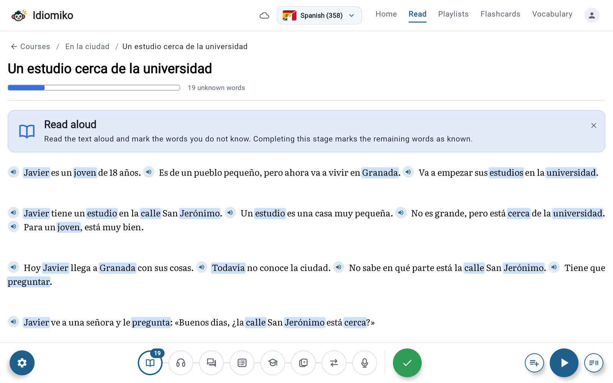

**Click (or tap) a word** to open its panel:

- the translation, which you can edit;
- the dictionary entry with every meaning: **+** adds one to your translation;
- a speaker button to hear it;
- the status buttons **New**, **Learning** and **Known**.

Setting a word to **Learning** turns it into a flashcard.

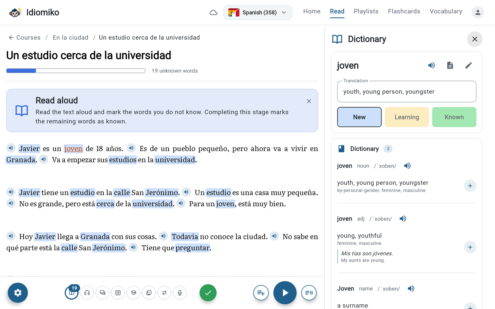

A few more things:

- **Phrases.** To save an expression as one term, drag across its words. You can also long-press the first word, then long-press the last.
- **Quick status.** Right-click a new word to start learning it, without opening the panel. Right-click a word you are learning to mark it known.
- **Listen.** The speaker before each sentence reads it aloud. The big play button at the bottom reads the whole page.
- **Hover for a hint.** On desktop, resting the pointer on a word shows its translation above it.

The gear button opens **Reader settings**. There you can:

- show a translation under each sentence, or side by side;
- put one sentence per line;
- blur the original to practise;
- change the voice, the speed, the font and the colours.

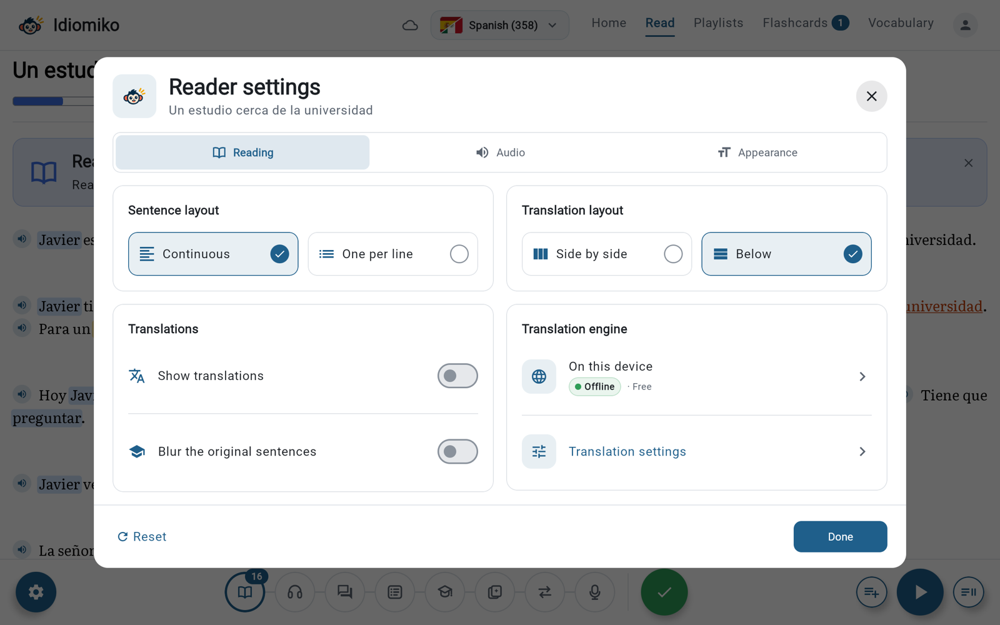

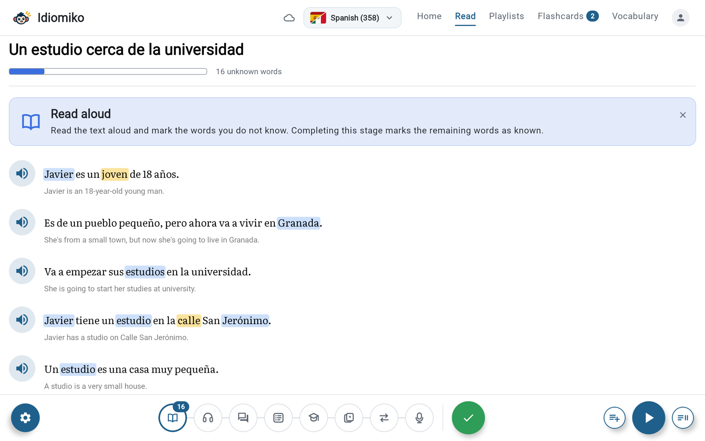

## Flashcards

**Flashcards › Review flashcards** (the badge shows how many are due) goes through your cards with
spaced repetition. Each card shows the word in the sentence where you saved it, with the word
blanked out.

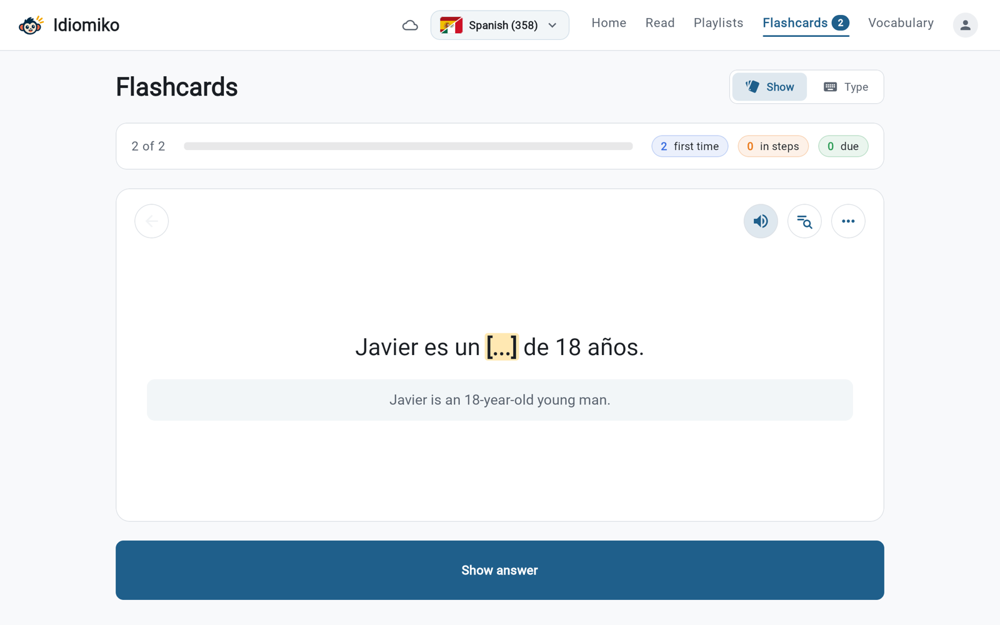

Try to recall the word, then press **Show answer** and grade yourself:

- **Again**: you didn't know it. It comes back in a minute.
- **Hard**, **Good** or **Easy**: you knew it. The better you knew it, the longer until you see it again.

Switch **Show** to **Type** at the top right to type the answer instead.

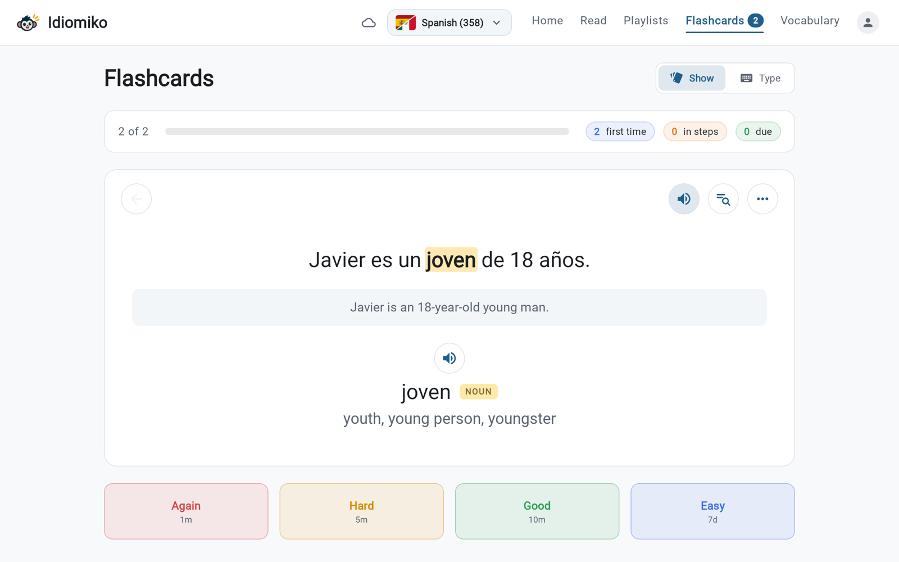

Keep at least a few minutes of reviews a day: the badge on **Flashcards** tells you when cards are
waiting.

## Vocabulary

**Vocabulary** lists every word you have saved. You can:

- search the list;
- filter it by status and sort it;
- change the status of many words at once;
- export the words to Anki.

**Vocabulary › Word frequency** shows the most common words of the language, coloured by how well
you know them. **Vocabulary › Statistics** shows your progress over time.

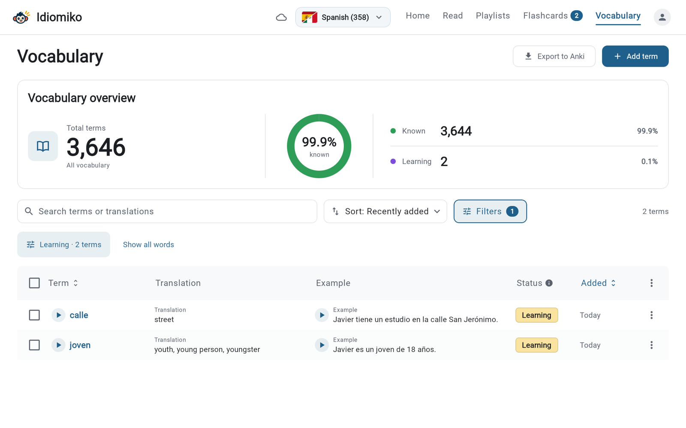

## Your own books and texts

**Read › Books › Add a book** lets you paste a text or import a file:

- e-books: EPUB, FB2, MOBI, AZW3;
- documents: DOCX, ODT, RTF, PDF (PDF not in the browser);
- web pages, Markdown and subtitles (SRT, VTT);
- photos of pages (desktop, Android and iOS).

Long texts are split into pages. The words-per-page box sets how long a page is.

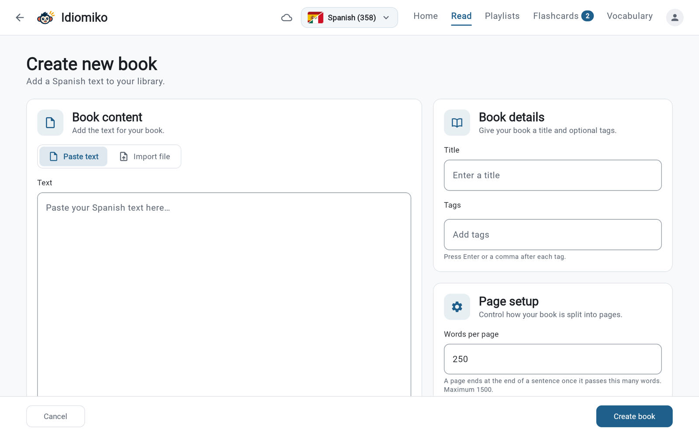

**Read › Find free books** searches free libraries such as Project Gutenberg, Wikisource and graded
children's readers. The **How hard?** slider keeps the results to books where you already know
enough of the words.

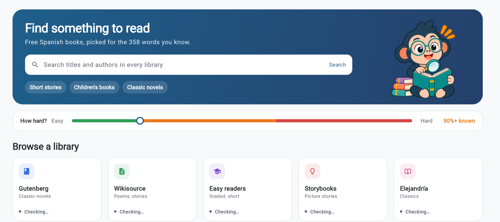

Finished books can be moved to **Read › Book archive** to keep the library short.

## News and Wikipedia

**Read › News** brings the latest articles from news sites in your language, with the easiest ones
first. The **Wikis** tab has the Wikipedia articles read most yesterday, or any article you search
for. Each card shows the share of words you know and how long it takes. **Read the introduction**
is a good bite-sized lesson.

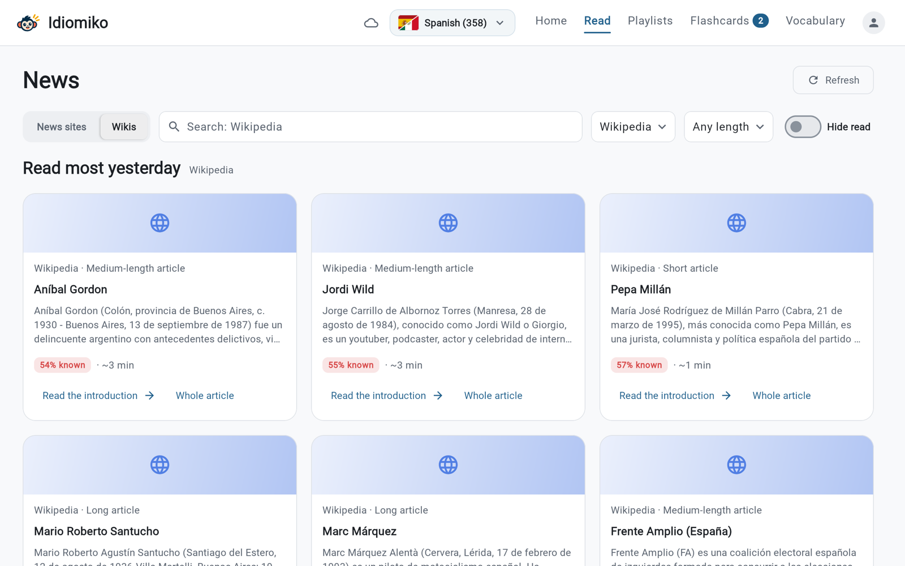

## Playlists

**Playlists** collect lessons, book chapters and articles to listen to one after another, like an
audiobook. Create a playlist, add texts from your library, or add the text you are reading from
the reader. Then press play: the player follows along sentence by sentence.

## On a phone

On a phone the main sections sit in the bottom bar:

- **Home**, **Read**, **Playlists** and **Flashcards**;
- **More**, which holds Vocabulary, Statistics, Speech, Translation and every settings page.

Your account is the avatar at the top right.

In a lesson, the stages sit above the player. The gear button opens the reader settings.

  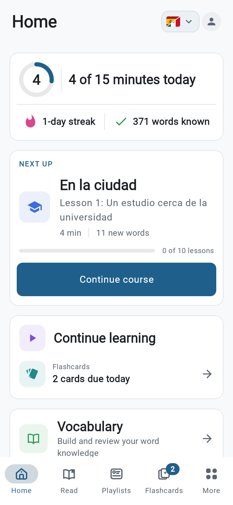
  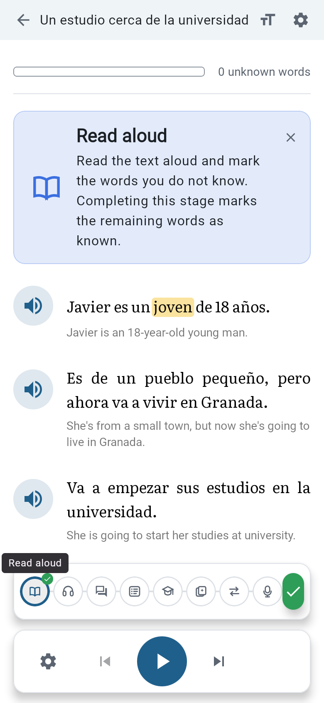
  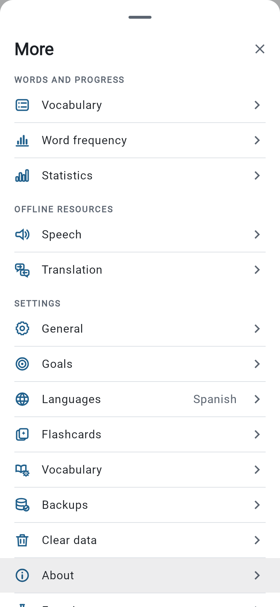

## Settings worth knowing

Open them from the avatar menu (**Settings**) or, on a phone, from **More**.

- **Speech.** Pick the voice engine:
  - **System voices**: the device's own voices.
  - **Piper**: offline neural voices.
  - **Kokoro**: a high-quality offline voice for a few languages.

  Download a voice once, try it with the play button, and it works offline from then on.

  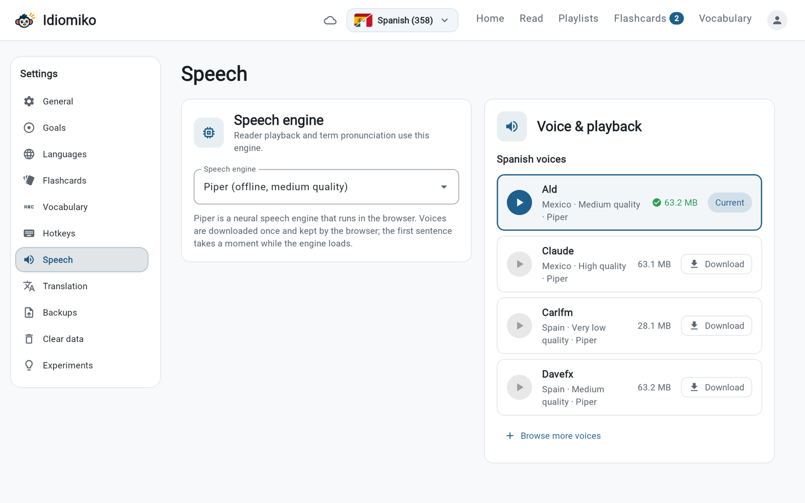
- **Translation.** Choose where sentence translations come from:
  - **MyMemory**: online and free.
  - **Google Translate**: needs your own API key.
  - **On this device**: works with no network after a one-time download.

  You can also import your own Yomitan, MDict or StarDict dictionaries here.
- **Backups.** **Create backup** saves your languages, books, vocabulary, reading history and
  settings to a file. **Choose file** restores one, on this device or another. Make one now and
  then, and always before reinstalling.

  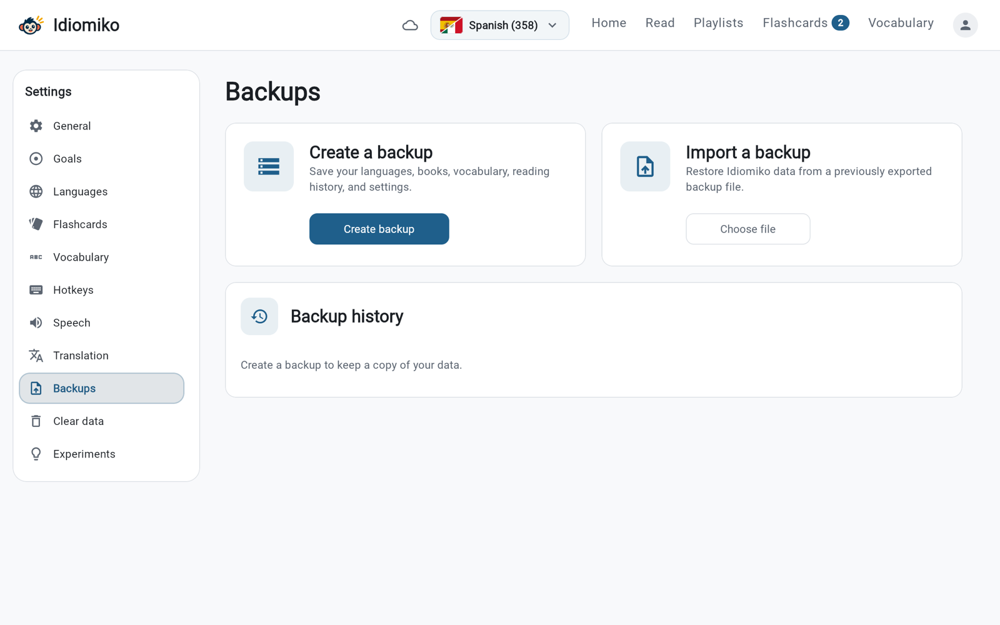
- **Account and sync.** Sign in from the avatar menu to keep your library the same on all your
  devices. You don't need an account to use Idiomiko. You can manage it on the web at
  [idiomiko.com/account](https://idiomiko.com/account).
- **General.** Theme, reading font, text size and line height, with a live preview.

  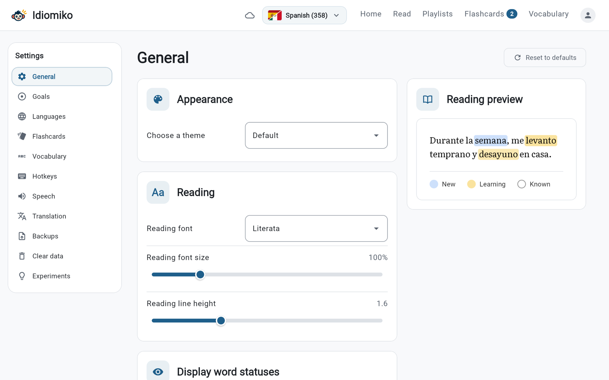

## Keyboard shortcuts

On desktop and in the browser. They can all be changed in **Settings › Hotkeys**.

| In the reader | |
| --- | --- |
| Space | Play or pause reading aloud |
| A / D | Previous / next sentence |
| S | Read the current sentence again |
| Ctrl + ← / → | Previous / next word |
| L, 2, 3, 4 | Set the selected word's learning level 1–4 |
| K | Mark the word as known |
| I | Ignore the word (names, numbers) |
| T | Translate the sentence |
| E | Show or hide the word panel |
| B | Bookmark the page |
| Shift + ← / → | Previous / next page |
| Ctrl + Plus / Minus | Larger / smaller text |

| In flashcards | |
| --- | --- |
| Space or Enter | Show the answer; press again for Good |
| 1 / 2 / 3 / 4 | Again / Hard / Good / Easy |
| ← | Back to the previous card |

On a Mac, use ⌘ where the table says Ctrl.

## Questions

**Does it work offline?**
Yes. The lessons, your books, the dictionary for your language and downloaded voices and
translation models all stay on the device. The news, online translation and sync need a connection.

**Where is my data?**
On your device. Nothing reaches the server unless you sign in to sync. Backups are ordinary files
you keep.

**A word is translated badly.**
Click it and edit the translation, or pick a better meaning from the dictionary with **+**.

**Names keep showing up as new words.**
Click the name and press **I** to ignore it, and it stops being highlighted.

**Something is wrong or missing?**
[Open an issue](https://github.com/zavanton123/tayra-languages/issues) or write to
hello@idiomiko.com.
