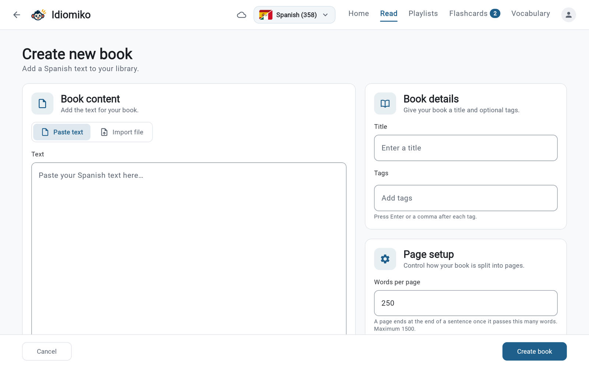
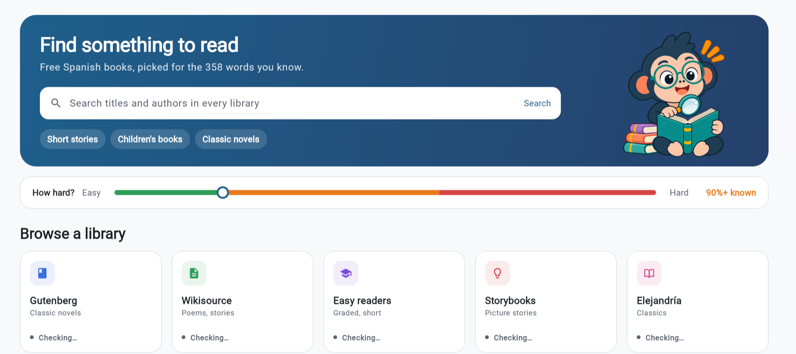

# Your own books and texts

**Read › Books › Add a book** lets you paste a text or import a file:

- e-books: EPUB, FB2, MOBI, AZW3;
- documents: DOCX, ODT, RTF, PDF (PDF not in the browser);
- web pages, Markdown and subtitles (SRT, VTT);
- photos of pages (desktop, Android and iOS).

Long texts are split into pages. The words-per-page box sets how long a page is.

**Read › Find free books** searches free libraries such as Project Gutenberg, Wikisource and graded
children's readers. The **How hard?** slider keeps the results to books where you already know
enough of the words.

Finished books can be moved to **Read › Book archive** to keep the library short.
