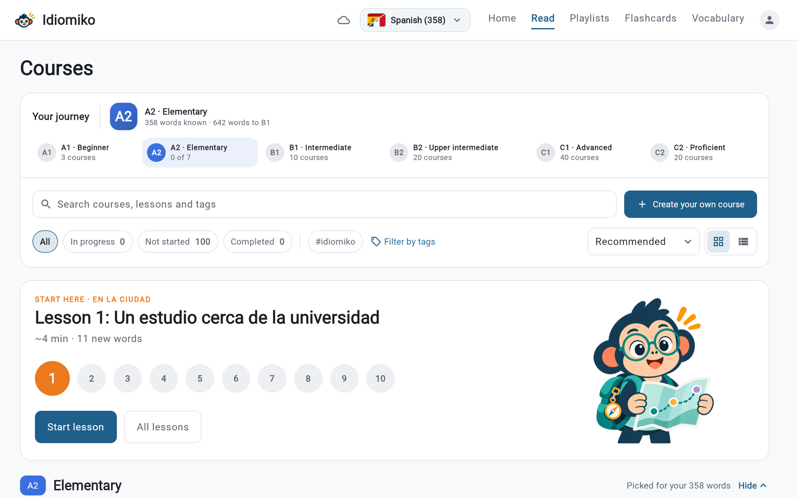
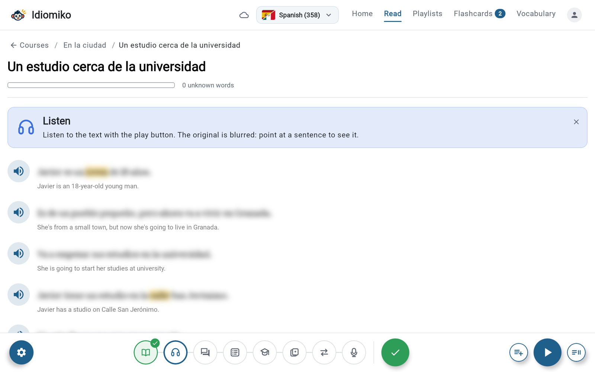

# Courses and lessons

**Read › Courses** has graded courses of short stories, from A1 to C2. The course for your level
comes first; the numbered circles are its lessons. **Create your own course** turns your own texts
into lessons.

A lesson takes a few minutes. Each lesson is worked through in stages, shown in the bar at the
bottom of the screen. The green tick finishes the current stage and moves to the next. Click any
stage's icon to jump straight to it.

| Stage | What you do |
| --- | --- |
| Read aloud | Read the text aloud and tap the words you don't know. Finishing it marks every other word as known. |
| Listen | Listen with the play button while the original is blurred. Point at, or on a phone tap, a sentence to see it. |
| Questions | Answer questions on the story, then compare with the blurred answer. |
| Check the words | Go over the page's words and fix their statuses. |
| Quiz | A quick quiz on the words you are learning. |
| Flashcards | Review today's cards without leaving the text. |
| Reverse translation | Say each translated sentence in the original, then compare. |
| Retell | Tell the story again, with only its translation in front of you. |

