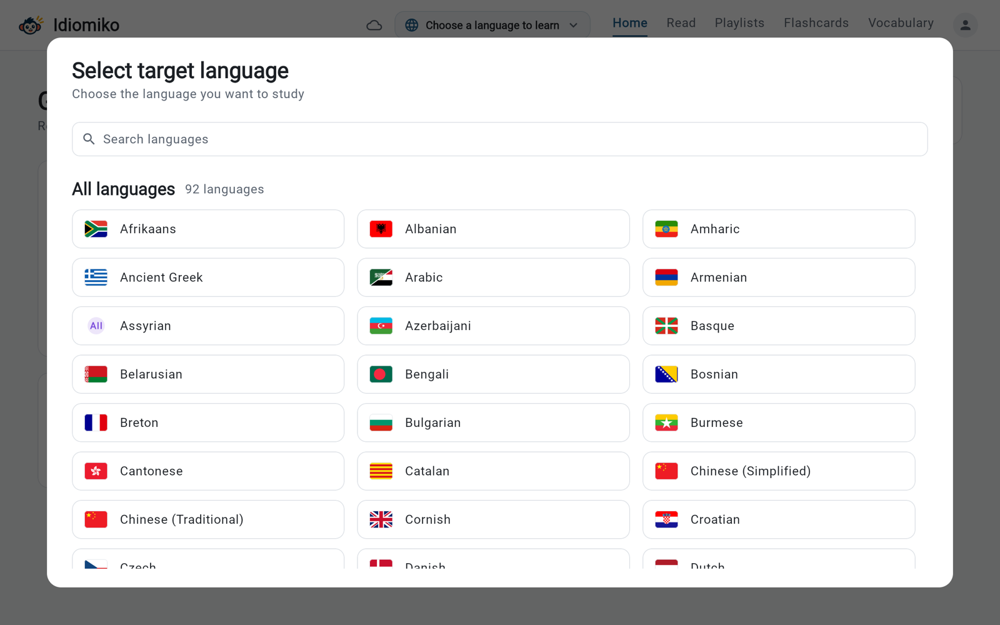
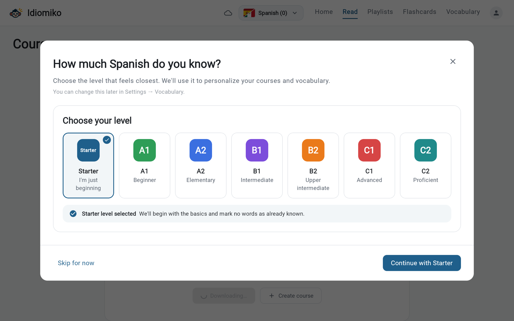

# First start

Pick the language you want to learn. Type in the search box to find it quickly.

Then say how much you already know. Idiomiko marks the most common words of your level as known,
so lessons only highlight what is new to you. You can change the level later in
**Settings › Vocabulary**.

To learn a second language, use the language button in the top bar. **Settings › Languages** also
sets the language meanings are shown in and the language of the app itself.
