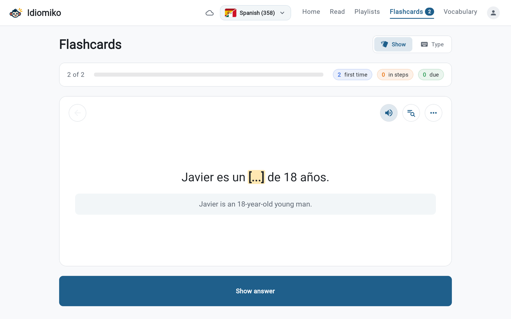
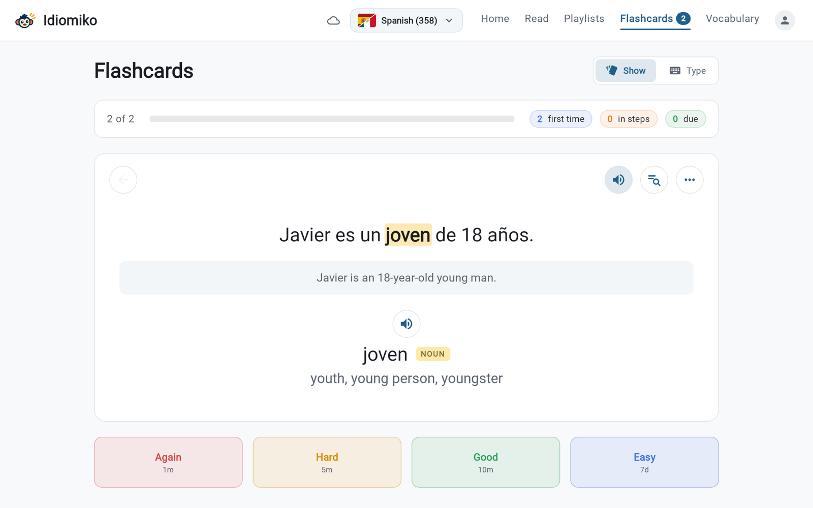

# Flashcards

**Flashcards › Review flashcards** (the badge shows how many are due) goes through your cards with
spaced repetition. Each card shows the word in the sentence where you saved it, with the word
blanked out.

Try to recall the word, then press **Show answer** and grade yourself:

- **Again**: you didn't know it. It comes back in a minute.
- **Hard**, **Good** or **Easy**: you knew it. The better you knew it, the longer until you see it again.

Switch **Show** to **Type** at the top right to type the answer instead.

Keep at least a few minutes of reviews a day: the badge on **Flashcards** tells you when cards are
waiting.
