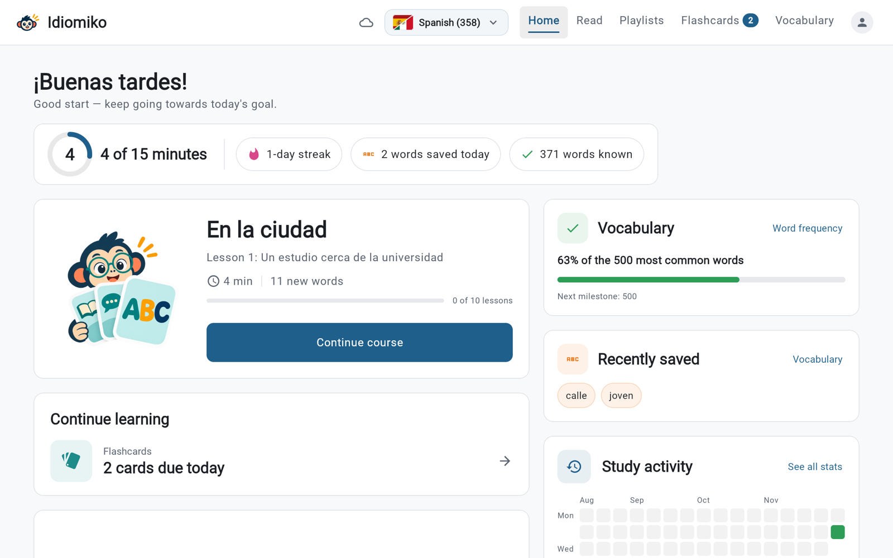

# Home

Home shows one suggested next step and what keeps you going:

- **Today's goal**: minutes of reading and flashcards. Change it in **Settings › Goals**.
- **Streak**: days in a row you studied. Click it to see your statistics.
- **Next up**: the next lesson, or your book, in one click.
- **Continue learning**: flashcards due today and anything you are halfway through.
- **Vocabulary**: how much of the most common words you know, and the words you saved recently.

