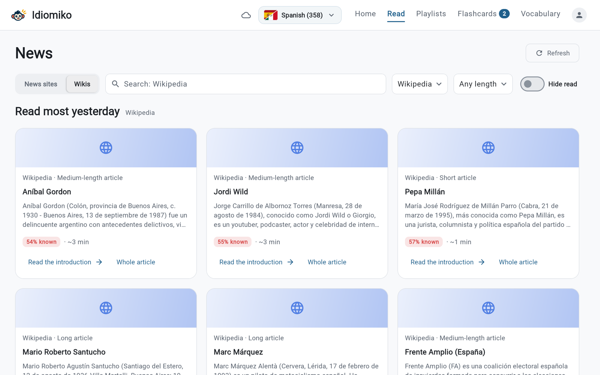

# News and Wikipedia

**Read › News** brings the latest articles from news sites in your language, with the easiest ones
first. The **Wikis** tab has the Wikipedia articles read most yesterday, or any article you search
for. Each card shows the share of words you know and how long it takes. **Read the introduction**
is a good bite-sized lesson.

