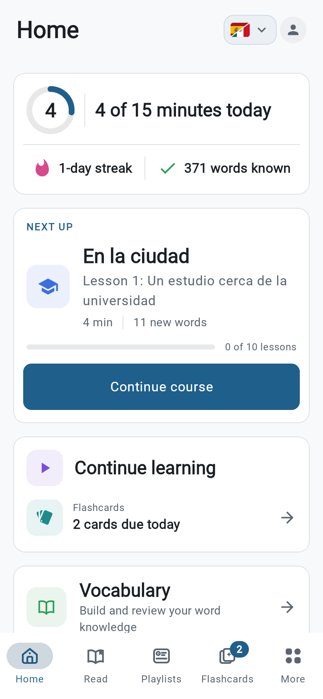
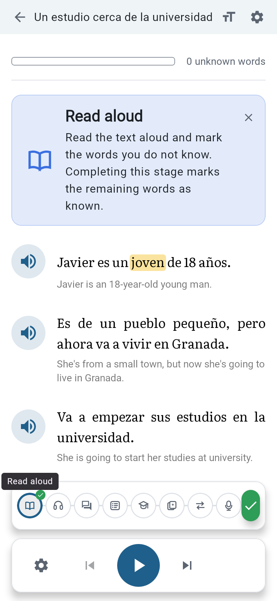
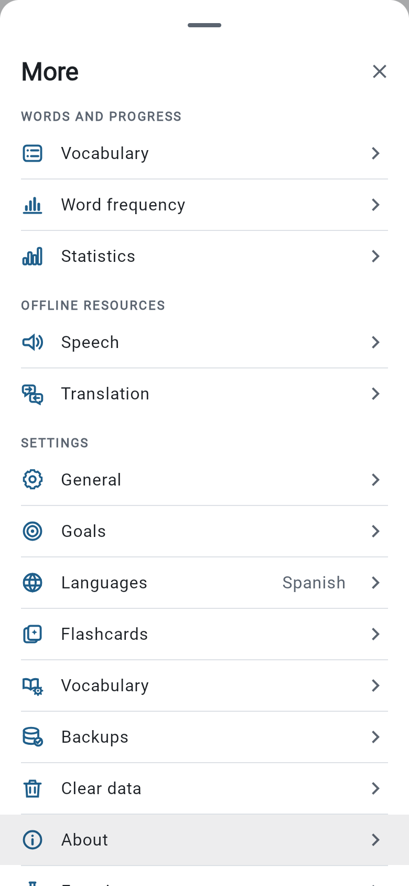

# On a phone

On a phone the main sections sit in the bottom bar:

- **Home**, **Read**, **Playlists** and **Flashcards**;
- **More**, which holds Vocabulary, Statistics, Speech, Translation and every settings page.

Your account is the avatar at the top right.

In a lesson, the stages sit above the player. The gear button opens the reader settings.

  
  
  

