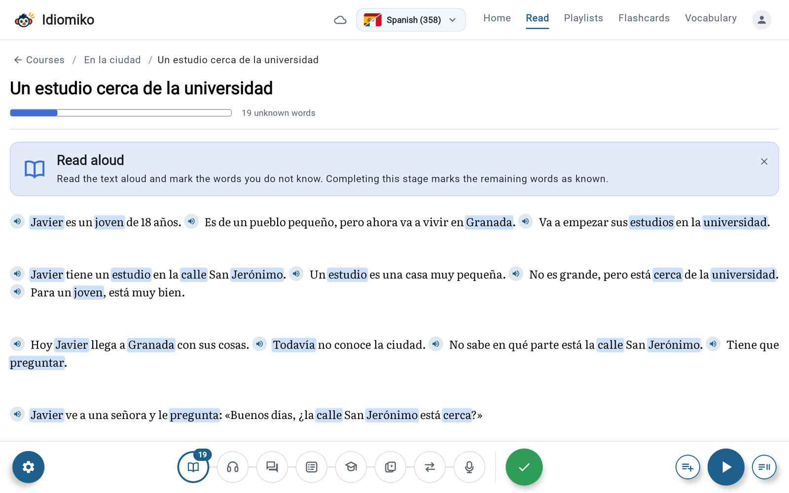
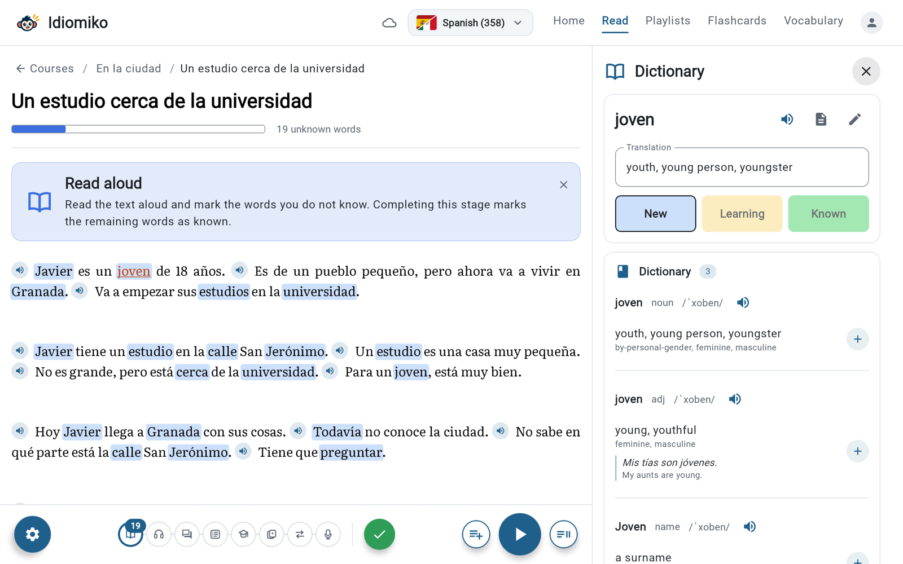
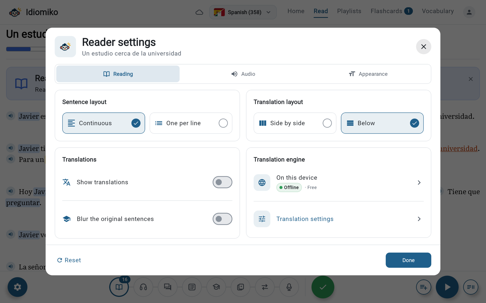
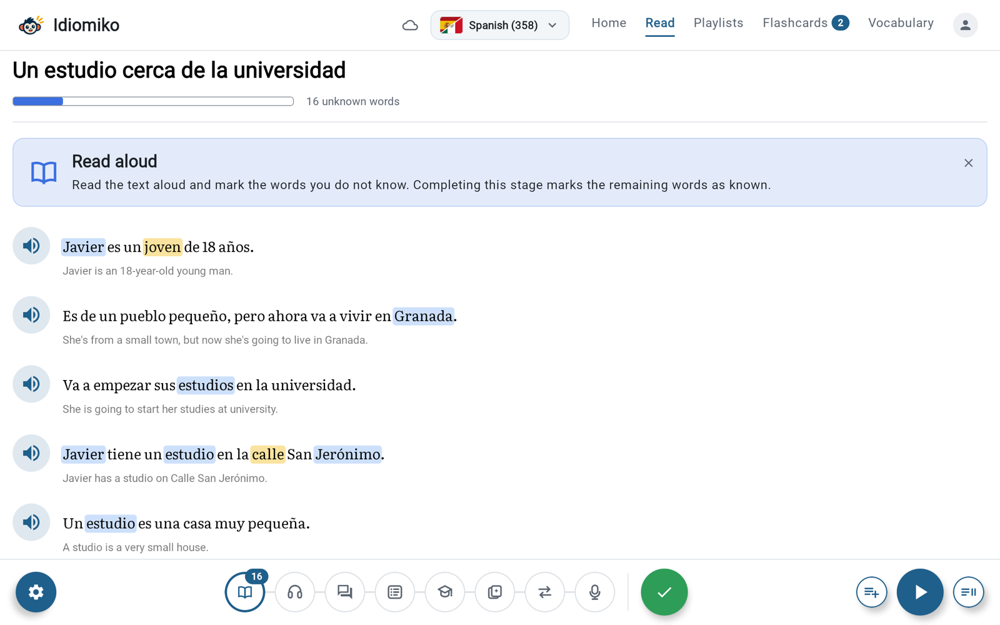

# Reading and saving words

Words you have never met are highlighted in blue, words you are learning in yellow, and known words
not at all. So a page shows at a glance how much is still new.

**Click (or tap) a word** to open its panel:

- the translation, which you can edit;
- the dictionary entry with every meaning: **+** adds one to your translation;
- a speaker button to hear it;
- the status buttons **New**, **Learning** and **Known**.

Setting a word to **Learning** turns it into a flashcard.

A few more things:

- **Phrases.** To save an expression as one term, drag across its words. You can also long-press the first word, then long-press the last.
- **Quick status.** Right-click a new word to start learning it, without opening the panel. Right-click a word you are learning to mark it known.
- **Listen.** The speaker before each sentence reads it aloud. The big play button at the bottom reads the whole page.
- **Hover for a hint.** On desktop, resting the pointer on a word shows its translation above it.

The gear button opens **Reader settings**. There you can:

- show a translation under each sentence, or side by side;
- put one sentence per line;
- blur the original to practise;
- change the voice, the speed, the font and the colours.

