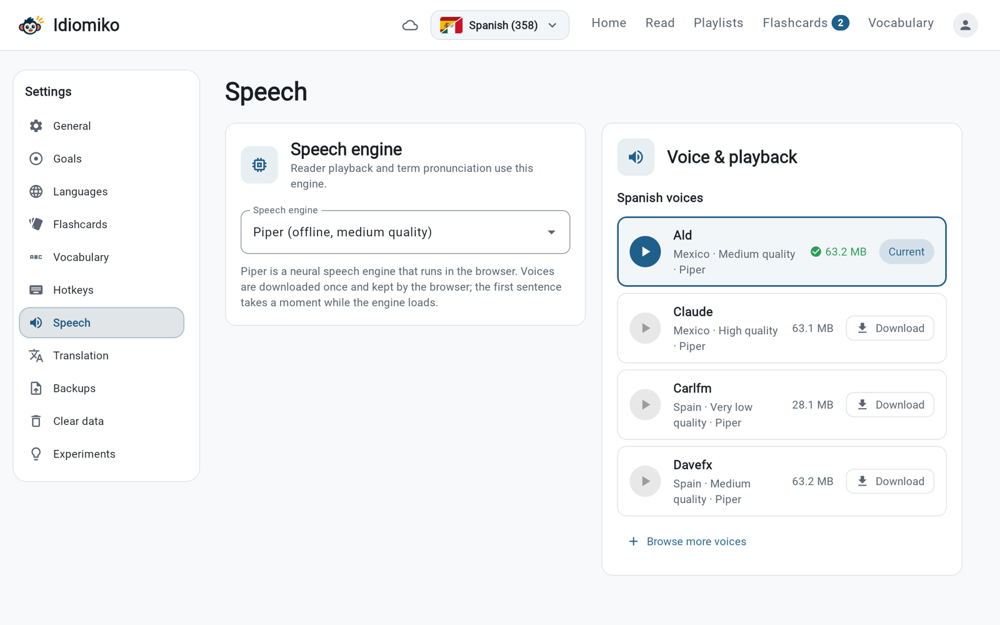
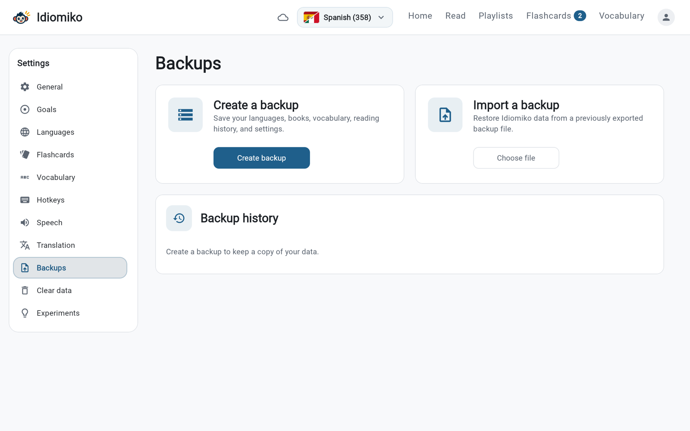
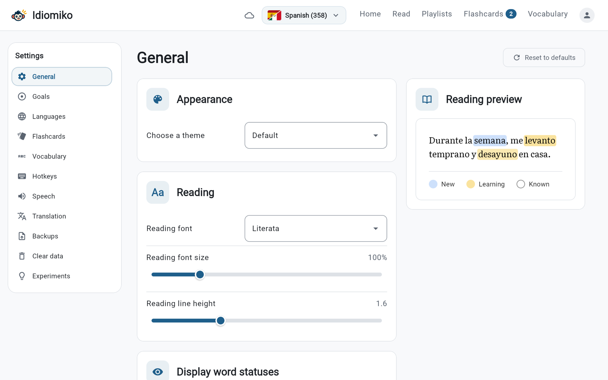

# Settings worth knowing

Open them from the avatar menu (**Settings**) or, on a phone, from **More**.

- **Speech.** Pick the voice engine:
  - **System voices**: the device's own voices.
  - **Piper**: offline neural voices.
  - **Kokoro**: a high-quality offline voice for a few languages.

  Download a voice once, try it with the play button, and it works offline from then on.

  
- **Translation.** Choose where sentence translations come from:
  - **MyMemory**: online and free.
  - **Google Translate**: needs your own API key.
  - **On this device**: works with no network after a one-time download.

  You can also import your own Yomitan, MDict or StarDict dictionaries here.
- **Backups.** **Create backup** saves your languages, books, vocabulary, reading history and
  settings to a file. **Choose file** restores one, on this device or another. Make one now and
  then, and always before reinstalling.

  
- **Account and sync.** Sign in from the avatar menu to keep your library the same on all your
  devices. You don't need an account to use Idiomiko. You can manage it on the web at
  [idiomiko.com/account](https://idiomiko.com/account).
- **General.** Theme, reading font, text size and line height, with a live preview.

  
