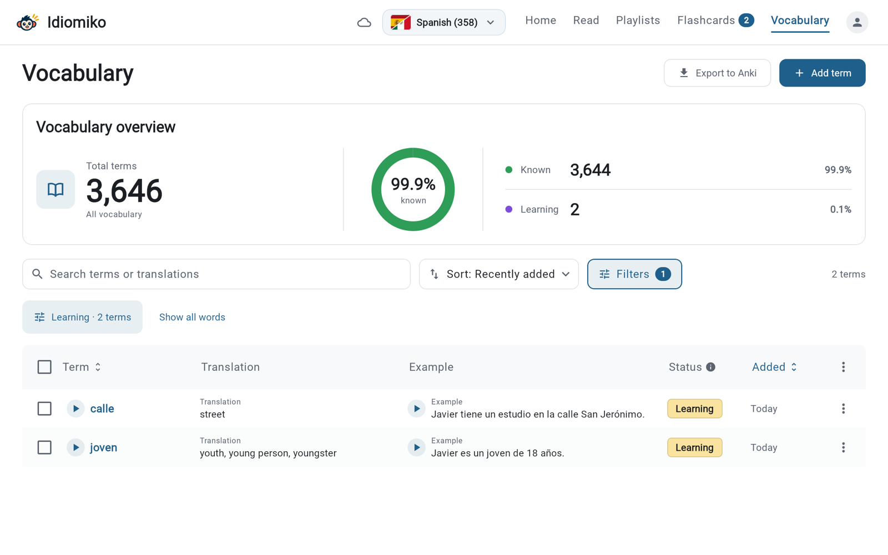

# Vocabulary

**Vocabulary** lists every word you have saved. You can:

- search the list;
- filter it by status and sort it;
- change the status of many words at once;
- export the words to Anki.

**Vocabulary › Word frequency** shows the most common words of the language, coloured by how well
you know them. **Vocabulary › Statistics** shows your progress over time.

